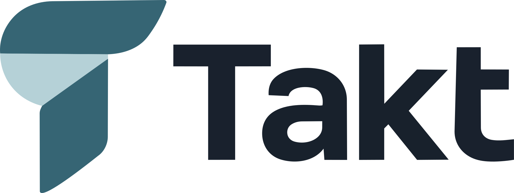
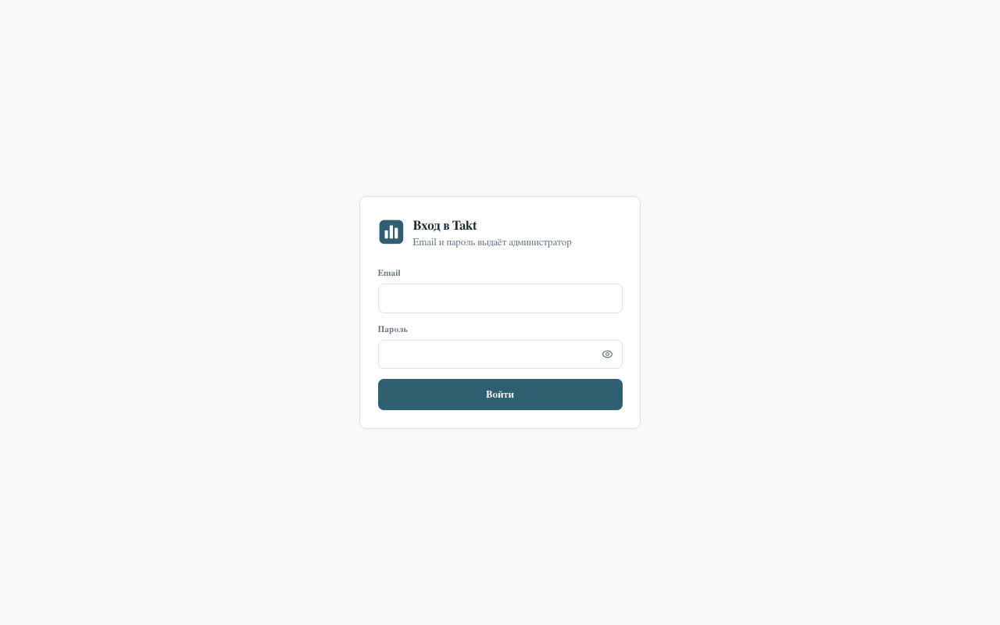
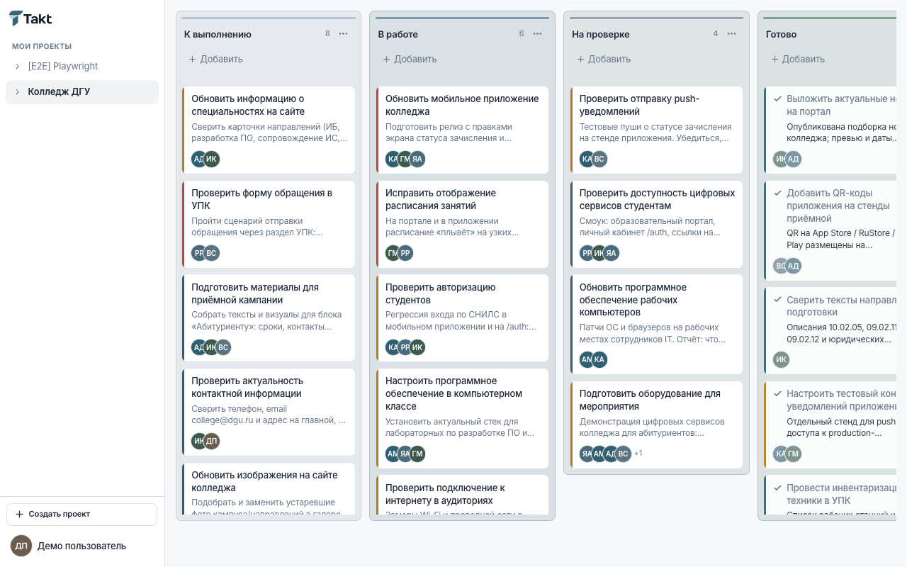
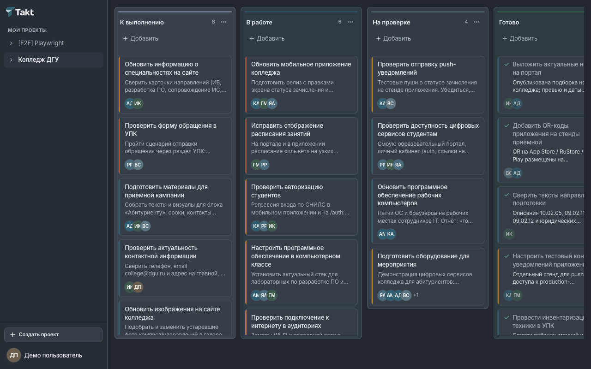
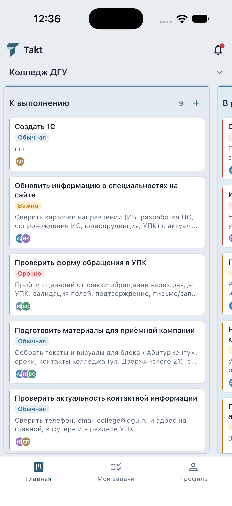
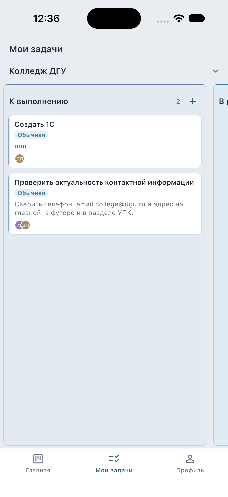
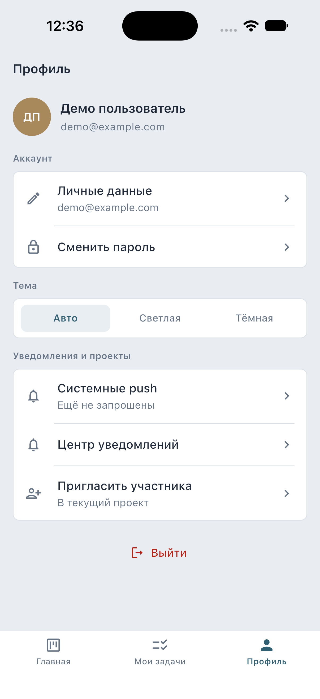
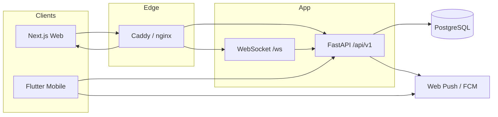

<p align="center">
  
</p>

<h1 align="center">Takt</h1>

<p align="center"><strong>Работа команды в одном ритме</strong></p>

<p align="center">
  Простой менеджер проектов и задач вокруг Kanban-доски.<br />
  Web (Next.js) · API (FastAPI) · Mobile (Flutter) · PostgreSQL
</p>

<p align="center">
  <a href="https://github.com/gadzhilaev/takt/actions/workflows/ci.yml"></a>
  <a href="https://taktapp.ru"></a>
</p>

---

## О продукте

Takt — это минималистичный Kanban для небольших команд: регистрация и вход, проекты, приглашения участников, доска со столбцами-состояниями, задачи с исполнителями и срочностью, уведомления (in-app, Web Push, FCM).

Без перегруженных дашбордов и сложных фильтров в основном UI. Демо-окружение изолировано (`projects.is_demo`).

**Репозиторий:** [github.com/gadzhilaev/takt](https://github.com/gadzhilaev/takt)  
**Production:** [taktapp.ru](https://taktapp.ru)

## Основные возможности

- Регистрация по email (OTP) и вход; OAuth: VK ID, Яндекс ID (web + mobile), Sign in with Apple (только mobile)
- Проекты с ролями участника (`admin` / `member` / `viewer`) и приглашениями in-app
- Kanban: 4 стартовых столбца, drag-and-drop, новая задача всегда в начало столбца
- Задача: название, описание, исполнители (0..n), приоритет, комментарии, чеклист
- Уведомления: in-app, Web Push (VAPID), FCM на mobile
- Платформенная админка `/admin` (модерация, пользователи, настройки OAuth)
- Home screen widgets (iOS / Android) без хранения JWT в виджете

## Скриншоты

### Web

| Вход | Доска (светлая) | Доска (тёмная) |
|------|-----------------|----------------|
|  |  |  |

### Mobile

| Доска | Мои задачи | Профиль |
|-------|------------|---------|
|  |  |  |

## Технологический стек

| Слой | Технологии |
|------|------------|
| Frontend | Next.js 14 (App Router), React 18, TanStack Query, dnd-kit, Tailwind CSS, Radix UI, Playwright, Vitest |
| Mobile | Flutter, Dio, go_router, flutter_bloc, home_widget, flutter_secure_storage, Firebase Messaging |
| Backend | FastAPI, SQLAlchemy 2 (async), Alembic, Pydantic v2, SlowAPI, pywebpush, firebase-admin |
| Data / infra | PostgreSQL 16, Docker Compose, Caddy / nginx edge |
| Auth | JWT (httpOnly cookies + CSRF на web; Bearer на mobile), OAuth PKCE |

## Архитектура системы



**Три оси прав:**

1. **Project RBAC** — `ProjectMemberRole` (viewer / member / admin) внутри проекта  
2. **Legacy `UserRole.admin`** — системный admin команды (доступ к non-demo проектам)  
3. **`platform_role`** — платформенная админка `/admin` (`none` → `moderator` → `admin` → `super_admin`)

Подробнее: [`docs/architecture/overview.md`](docs/architecture/overview.md), [`docs/security/README.md`](docs/security/README.md).

## Структура монорепозитория

```text
takt/
├── backend/           # FastAPI: api → services → models
├── frontend/          # Next.js: landing /, workspace /app/*, platform /admin
├── mobile/            # Flutter feature-first клиент
├── deploy/            # Production Compose, Caddy/nginx, server-deploy.sh
├── shared/icons/      # Lucide SVG (web + mobile symlink)
├── docs/              # Архитектура, API, security, deployment
├── docker-compose.yml # Локальный полный стек (db, backend, frontend, proxy)
├── AGENTS.md          # Правила для AI-агентов
└── .env.example       # Шаблон переменных окружения
```

Технические имена Docker/БД (`POSTGRES_USER=track`, `COMPOSE_PROJECT_NAME=track`) сохранены для совместимости с существующими volumes — это **не** название продукта.

## Быстрый запуск

### Вариант A — Docker (полный стек)

```bash
cp .env.example .env
# Задайте SECRET_KEY, POSTGRES_PASSWORD, ADMIN_PASSWORD
# Для уже существующих volumes оставьте COMPOSE_PROJECT_NAME=track

docker compose up --build -d
```

Откройте http://localhost — вход учёткой `ADMIN_*` из `.env`.

### Вариант B — локальная разработка

```bash
# 1. PostgreSQL
docker compose up db -d

# 2. Backend
cd backend
python -m venv .venv && source .venv/bin/activate
pip install -r requirements.txt
alembic upgrade head
uvicorn app.main:app --reload --port 8000

# 3. Frontend (другой терминал)
cd frontend && npm ci && npm run dev
# http://localhost:3000  (прокси /api и /ws → :8000)

# 4. Mobile (опционально)
cd mobile && flutter pub get
flutter run --dart-define=API_BASE=http://127.0.0.1:8000
# Android emulator: API_BASE=http://10.0.2.2:8000
```

Корневые npm-скрипты: `npm run db:up`, `npm run migrate`, `npm run backend`, `npm run dev`.

## Конфигурация окружения

Полный список — [`.env.example`](.env.example). Ключевые группы:

| Группа | Примеры |
|--------|---------|
| DB | `DATABASE_URL`, `POSTGRES_*`, порт хоста **5433** |
| Auth | `SECRET_KEY`, `COOKIE_*`, `ADMIN_*`, `DEMO_USER_*` |
| Email OTP | `SMTP_*`, `EMAIL_CODE_*` |
| Push | `VAPID_*`, `FCM_ENABLED`, `FIREBASE_CREDENTIALS_FILE` |
| OAuth | `OAUTH_*` — см. [`docs/OAUTH_SETUP.md`](docs/OAUTH_SETUP.md) |
| Frontend | `NEXT_PUBLIC_WS_URL`, `BACKEND_INTERNAL_URL` |

Секреты **не** коммитятся. Firebase client keys в `mobile/lib/firebase_options.dart` допустимы; service account — только вне git.

## Backend

```bash
cd backend
source .venv/bin/activate
alembic upgrade head          # миграции 001…012
uvicorn app.main:app --reload --port 8000
# OpenAPI: http://localhost:8000/docs
./.venv/bin/pytest -q
./.venv/bin/ruff check app tests
```

При старте приложения (lifespan) выполняется `alembic upgrade head` и bootstrap первого admin.

## Frontend

```bash
cd frontend
npm ci
npm run dev                   # http://localhost:3000
npm test                      # Vitest
npm run lint && npm run build
# E2E (нужны живые frontend+backend):
PW_CHANNEL=chrome npm run test:e2e
```

Маршруты: `/` лендинг · `/login` `/register` · workspace `/app/*` · platform admin `/admin`.

## Flutter

```bash
cd mobile
flutter pub get
flutter analyze && flutter test
flutter run --dart-define=API_BASE=http://127.0.0.1:8000
```

Подробности: [`mobile/docs/MOBILE_SETUP.md`](mobile/docs/MOBILE_SETUP.md) (FCM, виджеты, deep links `takt://`).

## База данных и миграции

- Движок: PostgreSQL 16  
- Миграции: `backend/alembic/versions/` (**001–012**, head = `012_platform_admin_oauth`)  
- Prod/dev runtime: Alembic в lifespan backend  
- Pytest: схема из ORM `Base.metadata` на БД `track_test` (не Alembic) — см. [`docs/testing/`](docs/testing/)

```bash
docker compose exec db pg_dump -U track track > backup_$(date +%F).sql
cat backup.sql | docker compose exec -T db psql -U track track
```

## Тестирование

| Слой | Команда |
|------|---------|
| Backend | `cd backend && ./.venv/bin/pytest -q` (нужен Postgres на `:5433`, БД `track_test`) |
| Frontend unit | `cd frontend && npm test` |
| Frontend E2E | `cd frontend && PW_CHANNEL=chrome npm run test:e2e` |
| Flutter | `cd mobile && flutter analyze && flutter test` |
| CI | [`.github/workflows/ci.yml`](.github/workflows/ci.yml) |

## Docker и развёртывание

- Локально: корневой `docker-compose.yml` (db + backend + frontend + Caddy)  
- Prod: `deploy/docker-compose.prod.yml` + [`deploy/DEPLOY.md`](deploy/DEPLOY.md)  
- Скрипт на сервере: `deploy/scripts/server-deploy.sh` (`/opt/takt`)  

Подробнее: [`docs/deployment/`](docs/deployment/).

## Безопасность

- JWT + CSRF для cookie-сессий; Bearer без CSRF  
- RBAC проектов на API (не только UI)  
- Rate limit (SlowAPI) на auth  
- Security headers middleware  
- Демо-проекты скрыты от системного admin без membership  

См. [`docs/security/README.md`](docs/security/README.md).

## Документация

Индекс: **[`docs/README.md`](docs/README.md)**

| Раздел | Содержание |
|--------|------------|
| [`docs/architecture/`](docs/architecture/) | Обзор, backend, frontend, mobile, БД |
| [`docs/api/`](docs/api/) | API v1, auth, ошибки |
| [`docs/features/`](docs/features/) | Проекты, Kanban, уведомления, OAuth, админка |
| [`docs/deployment/`](docs/deployment/) | Local, Docker, production |
| [`docs/testing/`](docs/testing/) | Pytest, Vitest, Playwright, Flutter |
| [`docs/decisions/`](docs/decisions/) | Architecture Decision Records |
| [`docs/contributing.md`](docs/contributing.md) | Конвенции и PR |
| [`AGENTS.md`](AGENTS.md) | Инструкции для AI-агентов |

Исторические отчёты аудитов: [`docs/archive/`](docs/archive/).

## Статус проекта

Активная разработка. Production: **https://taktapp.ru**.  
OAuth (VK / Яндекс) доступен при настроенных credentials; Apple — mobile-only и может быть ограничен политикой оператора РФ (149-ФЗ).

## Лицензия и авторство

Исходный код принадлежит автору репозитория ([@gadzhilaev](https://github.com/gadzhilaev)). Явная open-source лицензия в репозитории пока не опубликована — уточняйте условия использования у владельца.
