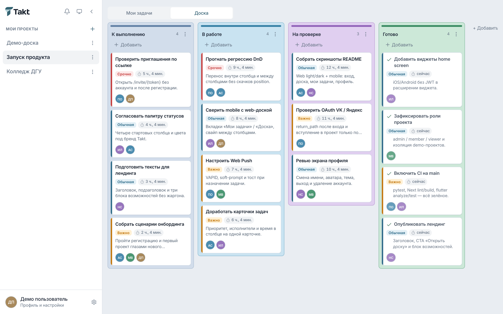
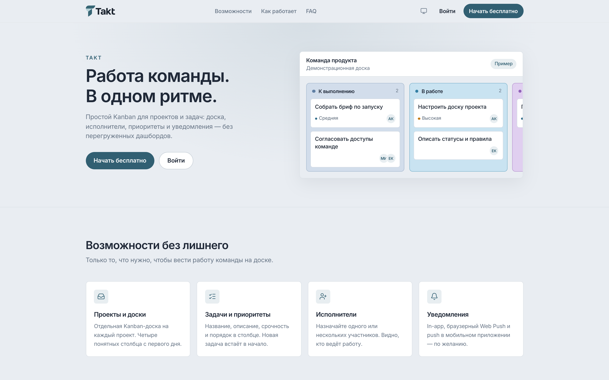
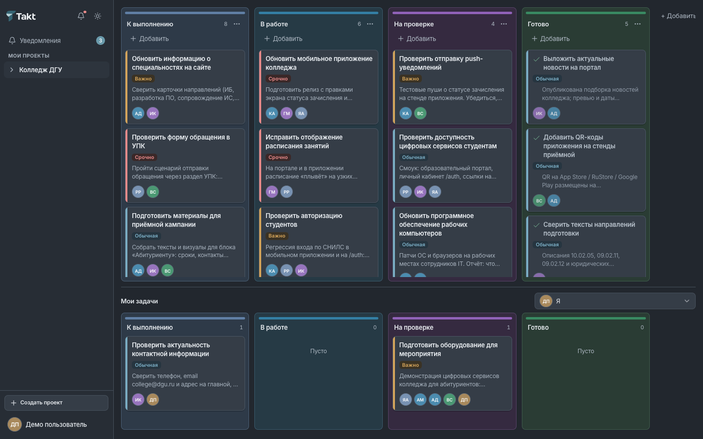
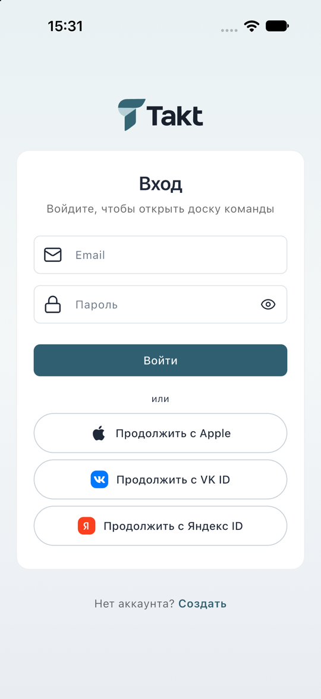
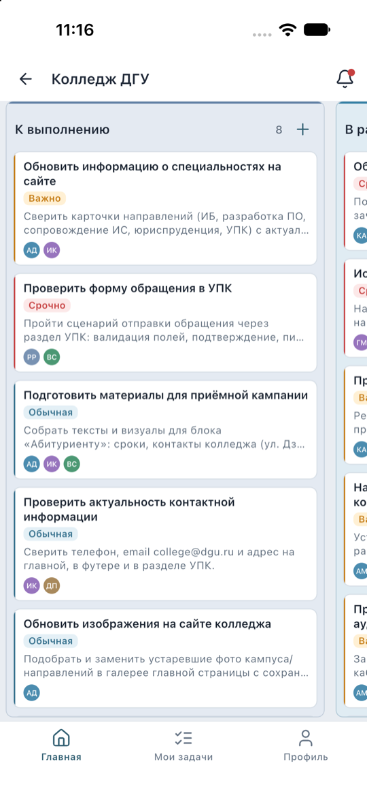
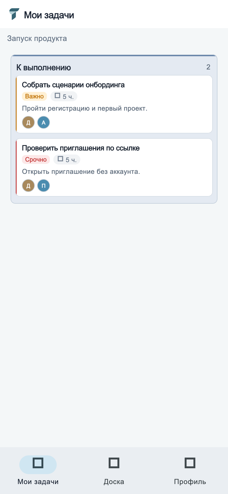
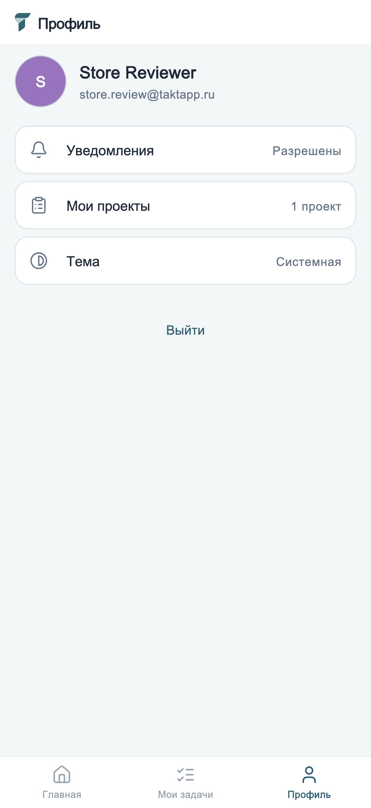
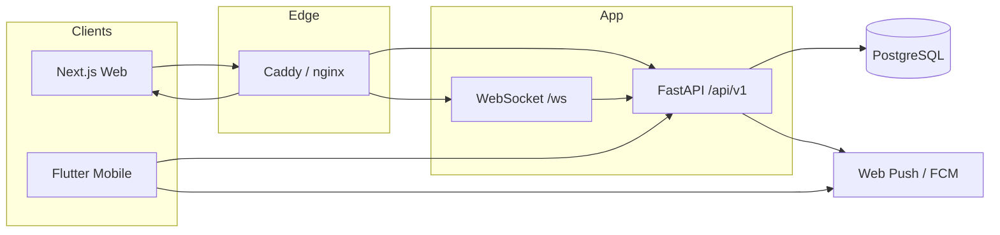

<p align="center">
  
</p>

<h1 align="center">Takt</h1>

<p align="center"><strong>Работа команды. В одном ритме.</strong></p>

<p align="center">
  Простой менеджер проектов и задач вокруг Kanban-доски.<br />
  Web · API · Mobile · PostgreSQL
</p>

<p align="center">
  <a href="https://taktapp.ru">taktapp.ru</a>
  ·
  <a href="docs/README.md">Документация</a>
  ·
  <a href=".github/workflows/ci.yml">CI</a>
</p>

---

## О продукте

Takt помогает небольшим командам вести проекты на одной доске: регистрация и вход, проекты и участники, столбцы-состояния, задачи с исполнителями и срочностью, уведомления.

Без перегруженных дашбордов и сложных фильтров в основном UI. Демо-окружение изолировано (`projects.is_demo`).

## Возможности

- Регистрация по email (OTP), вход по паролю, сброс забытого пароля кодом из письма
- OAuth: VK ID и Яндекс ID (web + mobile); Sign in with Apple — только в мобильном приложении (см. [`docs/oauth.md`](docs/oauth.md))
- Проекты с ролями `admin` / `member` / `viewer` и приглашениями in-app
- Kanban: 4 стартовых столбца, drag-and-drop; новая задача всегда в начало столбца
- Задача: название, описание, исполнители (0..n), приоритет, комментарии, чеклист
- Уведомления: in-app, Web Push (VAPID), FCM на mobile
- Платформенная админка `/admin` (пользователи, модерация, настройки OAuth)
- Home screen widgets (iOS / Android) без JWT в виджете

## Интерфейс

### Web

Актуальная Kanban-доска проекта (демо «Колледж ДГУ»): столбцы, приоритеты, исполнители, блок «Мои задачи».

<p align="center">
  
</p>

<p align="center"><em>Светлая тема · доска проекта</em></p>

Публичный лендинг:

<p align="center">
  
</p>

Тёмная тема доски:

<p align="center">
  
</p>

### Mobile

Flutter-клиент: вход (email + VK / Яндекс / Apple), доска, мои задачи, профиль.

<p align="center">
  
  &nbsp;&nbsp;
  
</p>

<p align="center">
  <sub>Вход · Доска</sub>
</p>

<p align="center">
  
  &nbsp;&nbsp;
  
</p>

<p align="center">
  <sub>Мои задачи · Профиль</sub>
</p>

## Стек

| Слой | Технологии |
|------|------------|
| Frontend | Next.js 14 (App Router), React 18, TanStack Query, dnd-kit, Tailwind CSS, Playwright, Vitest |
| Mobile | Flutter, Dio, go_router, flutter_bloc, home_widget, flutter_secure_storage, Firebase Messaging |
| Backend | FastAPI, SQLAlchemy 2 (async), Alembic, Pydantic v2, SlowAPI, pywebpush, firebase-admin |
| Infra | PostgreSQL 16, Docker Compose, Caddy / nginx |
| Auth | JWT (httpOnly cookies + CSRF на web; Bearer на mobile), OAuth PKCE |

## Архитектура



Три оси прав: project RBAC · legacy `UserRole.admin` · `platform_role` для `/admin`.  
Подробнее: [`docs/architecture.md`](docs/architecture.md), [`docs/security.md`](docs/security.md).

```text
takt/
├── backend/     # FastAPI
├── frontend/    # Next.js: / лендинг, /app workspace, /admin
├── mobile/      # Flutter
├── deploy/      # Prod Compose и server-deploy.sh
├── docs/        # Архитектура, API, security, deployment
└── docker-compose.yml
```

Технические имена Docker/БД (`POSTGRES_USER=track`, `COMPOSE_PROJECT_NAME=track`) сохранены для совместимости с volumes — это не название продукта.

## Быстрый запуск

### Docker

```bash
cp .env.example .env
# SECRET_KEY, POSTGRES_PASSWORD, ADMIN_PASSWORD
docker compose up --build -d
```

Откройте http://localhost — вход учёткой `ADMIN_*` из `.env`.

### Локальная разработка

```bash
docker compose up db -d

cd backend && python -m venv .venv && source .venv/bin/activate
pip install -r requirements.txt && alembic upgrade head
uvicorn app.main:app --reload --port 8000

cd frontend && npm ci && npm run dev   # http://localhost:3000

cd mobile && flutter pub get
flutter run --dart-define=API_BASE=http://127.0.0.1:8000
# Android emulator: API_BASE=http://10.0.2.2:8000
```

Переменные: [`.env.example`](.env.example). OAuth: [`docs/oauth.md`](docs/oauth.md).  
Mobile: [`mobile/docs/MOBILE_SETUP.md`](mobile/docs/MOBILE_SETUP.md).  
Prod: [`deploy/DEPLOY.md`](deploy/DEPLOY.md).

Миграции Alembic **001–013** (head `013_email_code_reset_password`). При старте backend выполняет `alembic upgrade head`.

## Тестирование

```bash
cd backend  && ./.venv/bin/pytest -q && ./.venv/bin/ruff check app tests
cd frontend && npm test && npm run lint && npm run build
cd mobile   && flutter analyze && flutter test
```

E2E (нужны живые frontend + backend): `cd frontend && PW_CHANNEL=chrome npm run test:e2e`.  
CI: [`.github/workflows/ci.yml`](.github/workflows/ci.yml). Подробнее: [`docs/development.md`](docs/development.md).

## Документация

Индекс: **[`docs/README.md`](docs/README.md)**

| Раздел | Содержание |
|--------|------------|
| [`docs/architecture.md`](docs/architecture.md) | Web, Backend, Flutter, БД |
| [`docs/api.md`](docs/api.md) | API v1, auth, ошибки |
| [`docs/features.md`](docs/features.md) | Возможности продукта |
| [`docs/security.md`](docs/security.md) | RBAC, CSRF, секреты |
| [`docs/development.md`](docs/development.md) | Локальная разработка и тесты |
| [`docs/deployment.md`](docs/deployment.md) | Docker и production |
| [`docs/oauth.md`](docs/oauth.md) | Настройка OAuth |
| [`AGENTS.md`](AGENTS.md) | Правила для AI-агентов |

## Статус и лицензия

Активная разработка. Production: **https://taktapp.ru**.

- Web: Kanban, проекты, участники, единый вход `/login`, платформенная админка `/admin` (light-only)
- Mobile: доска, мои задачи, профиль, home widgets; OAuth VK / Яндекс / Apple на экране входа
- OAuth на prod: VK ID и Яндекс ID (web + mobile), Sign in with Apple — только mobile  
  Политика оператора и 149-ФЗ: [`docs/oauth.md`](docs/oauth.md)

Исходный код принадлежит [@gadzhilaev](https://github.com/gadzhilaev). Явная open-source лицензия пока не опубликована.
