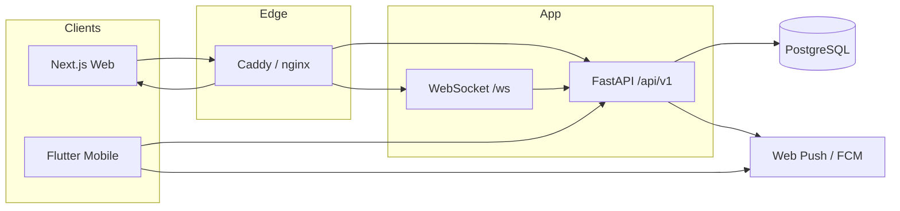
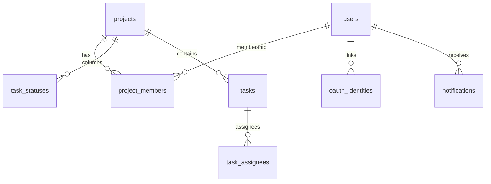

# Архитектура Takt

Монорепозиторий: один FastAPI API, web (Next.js 14) и mobile (Flutter).

## Компоненты

| Компонент | Путь | Роль |
|-----------|------|------|
| API | `backend/` | Бизнес-правила, ACL, данные |
| Web | `frontend/` | Лендинг, workspace Kanban, platform admin |
| Mobile | `mobile/` | iOS/Android + home widgets |
| Proxy | `deploy/` + Compose `proxy` | TLS; `/` → frontend, `/api` `/ws` → backend |
| DB | PostgreSQL 16 | Volumes с legacy-префиксом `track_*` |




## Принятые решения (кратко)

| Тема | Решение |
|------|---------|
| Бренд vs infra | Продукт **Takt**; Docker/БД ids `track` / `track_*` сохранены ради volumes |
| Auth | Один JWT: web — httpOnly cookies + CSRF; mobile — Bearer в secure storage |
| RBAC | Три оси: `ProjectMemberRole` · legacy `UserRole.admin` · `platform_role` (`/admin`) |
| Workspace | Список `/projects` — **только членство** (даже для legacy admin) |
| UI | Основной продукт = проекты + Kanban; report/dashboard UI не возвращать без запроса |
| Apple | Sign in with Apple — только mobile (см. [oauth.md](oauth.md)) |

## Потоки данных

1. **Auth web:** login → cookies + CSRF → mutating requests с заголовком CSRF.
2. **Auth mobile:** login/OAuth → токены в secure storage → `Authorization: Bearer`.
3. **Доска:** проекты → statuses → tasks → move/PATCH; realtime через `/ws`.
4. **Уведомления:** `notify_service` → in-app + опционально Web Push / FCM.
5. **Демо:** `projects.is_demo` / `users.is_demo`; системный admin без membership demo не видит.

## Границы ответственности

- UI **не** граница безопасности. ACL — `project_service.ensure_project_access` и platform deps.
- Бизнес-правила (позиция задачи, soft-delete только автором, demo) — в `backend/app/services/`.
- Клиенты дублируют DTO для UX, но не «вторую правду» по ACL.

## Backend (FastAPI)

```text
backend/app/
├── main.py              # lifespan: migrate + bootstrap, CORS, headers
├── api/deps.py          # JWT user, CSRF, platform RBAC
├── api/v1/              # HTTP routes
├── services/            # application logic
├── models/ · schemas/   # SQLAlchemy 2 · Pydantic v2
└── core/ · db/
```

Поток: **Route → Service → ORM**.  
Depends: `get_db`, `get_current_user` (cookie или Bearer), `verify_csrf` (пропуск при Bearer / `ENV=test`), `require_platform_*`.

| Router | Назначение |
|--------|------------|
| `auth` | login, register OTP, forgot-password, refresh, me |
| `oauth` | start/callback/mobile, identities |
| `users` | профиль, `DELETE /users/me` (удаление аккаунта) |
| `projects` | CRUD, members, leave, invites |
| `tasks` | CRUD, move, comments, checklist (+ project ACL) |
| `settings` | столбцы проекта |
| `notifications` | in-app + device tokens / Web Push |
| `admin` | legacy workspace admin users |
| `platform` | platform console API |
| `reports` | агрегаты / Excel (API есть; web UI упрощён) |
| `files` | avatars / logo |
| `ws` | realtime (вне `/api/v1`) |

Ограничения: login lockout — **in-memory** (не multi-worker); pytest поднимает схему через ORM, не Alembic.

## API v1

Базовый префикс: **`/api/v1`**. Swagger/ReDoc: `/docs`, `/redoc`. Health: `GET /health`. WS: `WS /ws`.

| Клиент | Механизм |
|--------|----------|
| Web | httpOnly `access_token` / `refresh_token` + `csrf_token`; CSRF на POST/PATCH/DELETE |
| Mobile | JSON-токены; `Authorization: Bearer …` (CSRF не нужен) |

Основные ресурсы: `/auth/*`, `/projects`, `/settings/statuses`, `/tasks` (+ `/move`), `/invites`, `/notifications`, `/users/me`, `/platform/*`, `/admin/*`.

Списки задач **без** `project_id` ограничены доступными проектами. Доступ к задаче — через membership её проекта.

Пагинация: `page`, `page_size` (доска часто `page_size=1000`) → `{ items, total, page, page_size }`.

Ошибки:

```json
{ "detail": { "error": { "code": "forbidden", "message": "…" } } }
```

Контракт **v1** — ломающие изменения без миграции клиентов не допускаются.

## Frontend (Next.js 14)

| URL | Назначение |
|-----|------------|
| `/` | Лендинг; authed → `/app/projects` |
| `/login`, `/register`, `/forgot-password` | Auth + OAuth (VK / Яндекс) |
| `/account-delete` | Удаление аккаунта (в т.ч. для магазинов) |
| `/app/*` | Workspace |
| `/admin/*` | Platform admin (`platform_role`) |
| `/app/admin` | Workspace users (`/api/v1/admin`) — **не** platform |

Канон путей: `frontend/src/lib/paths.ts`. Состояние: TanStack Query. API: cookies + CSRF. UI-токены: `globals.css`, акцент `#315F72`.

## Mobile (Flutter)

```text
mobile/lib/
├── main.dart / app.dart
├── core/          # ApiClient, router, theme, FCM
├── features/      # auth, board, projects, my_tasks, notifications, profile, widget_sync
└── shared/
```

- `AuthCubit`, `BoardCubit` глобально; HTTP в репозиториях.
- Bearer; OAuth deep link `takt://oauth/callback`; Apple только mobile.
- Widgets: App Group `group.ru.gadzhilaev.takt`; **JWT в виджет не пишется**.
- `--dart-define=API_BASE=…` (Android emulator: `http://10.0.2.2:8000`).

Подробнее: [`../mobile/docs/MOBILE_SETUP.md`](../mobile/docs/MOBILE_SETUP.md), [release.md](release.md).

## Продуктовая модель

- **Проект:** создатель → `ProjectMemberRole.admin`; роли admin / member / viewer; 4 стартовых столбца; `is_demo`.
- **Задача:** title, description, priority, **исполнители ≥1**, labels, due date, checklist, comments. Создание: `position = min(column) − 1024`. Soft-delete только автором.
- **Приглашения:** in-app (email или открытая ссылка); SMTP не имитировать, если не настроен.
- **Уведомления:** assignment / completion / invites; Web Push (VAPID), FCM.
- **Админки:** platform `/admin` ≠ project admin ≠ `/app/admin`.

## База данных

PostgreSQL 16. Технические имена по умолчанию: `track` / `track`. Хост-порт Docker: **5433**.  
Миграции `backend/alembic/versions/` — **001–020** (head `020_due_basis_auto_urgency`). Runtime: `alembic upgrade head` в lifespan.

| Rev | Суть |
|-----|------|
| 001–002 | Initial + projects |
| 003 | Invites |
| 004 | Web Push |
| 005–006 | `is_demo` |
| 007 | FCM device tokens |
| 008–009 | Цвета статусов |
| 010 | Leave requests |
| 011 | Email OTP |
| 012 | `platform_role`, OAuth, moderation |
| 013 | Forgot-password codes |
| 014 | Invite email nullable (open link) |
| 015 | OAuth `return_path` |
| 016 | `tasks.status_entered_at` |



См. также [security.md](security.md), [development.md](development.md).
