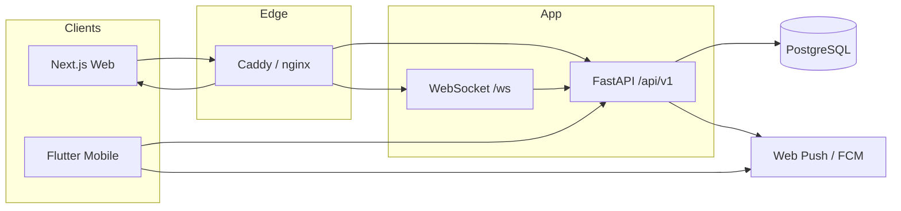
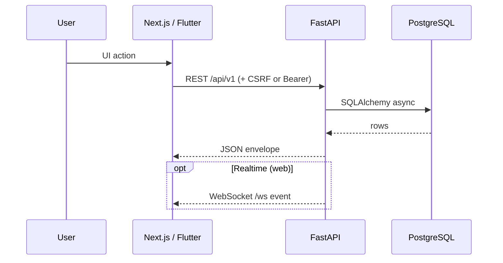
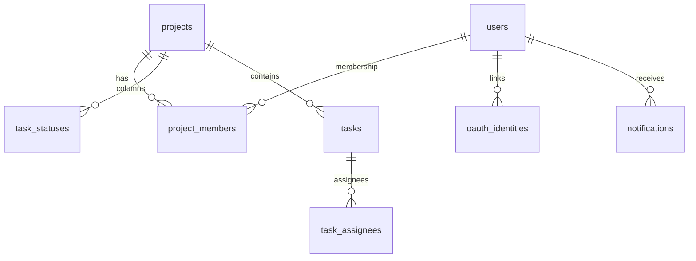

# Архитектура Takt

Монорепозиторий с тремя клиентами к одному API.

## Компоненты

| Компонент | Путь | Роль |
|-----------|------|------|
| API | `backend/` | Единый источник бизнес-правил и данных |
| Web | `frontend/` | Лендинг, workspace Kanban, platform admin |
| Mobile | `mobile/` | Flutter iOS/Android + home widgets |
| Proxy | `deploy/` + Compose `proxy` | TLS, `/` → frontend, `/api` `/ws` → backend |
| DB | PostgreSQL 16 | Volumes с legacy-префиксом `track_*` |





## Потоки данных

1. **Auth web:** login → httpOnly JWT cookies + CSRF cookie → mutating requests с заголовком CSRF.
2. **Auth mobile:** login/OAuth → токены в secure storage → `Authorization: Bearer`.
3. **Доска:** `GET /projects` → statuses → tasks → move/PATCH.
4. **Уведомления:** `notify_service` → in-app + опционально Web Push / FCM.
5. **Демо:** `is_demo` на project/user; системный admin не видит demo без membership.

## Границы ответственности

- UI **не** граница безопасности. ACL — в `project_service.ensure_project_access` и platform deps.
- Бизнес-правила (позиция задачи, удаление только автором, изоляция demo) — в `backend/app/services/`.
- Клиенты дублируют DTO для UX, но не «вторую правду» по ACL.

## Backend (FastAPI)

```text
backend/app/
├── main.py              # lifespan: migrate + bootstrap, CORS, headers
├── api/
│   ├── deps.py          # JWT user, CSRF, platform RBAC
│   ├── auth_cookies.py  # cookies + UserPublic
│   └── v1/              # HTTP routes
├── services/            # application logic
├── models/              # SQLAlchemy 2 ORM
├── schemas/             # Pydantic v2
├── core/                # config, security, csrf, limiter
└── db/session.py
```

Поток: **Route → Service → ORM**.

**Depends:** `get_db`, `get_current_user` (cookie или Bearer), `verify_csrf` (пропуск при Bearer / `ENV=test`), `require_platform_*`.

| Router | Назначение |
|--------|------------|
| `auth` | login, register OTP, refresh, me |
| `oauth` | start/callback/mobile, identities |
| `projects` | CRUD, members, leave |
| `tasks` | CRUD, move, comments, checklist (+ project ACL) |
| `settings` | столбцы проекта |
| `invites` | приглашения |
| `notifications` | in-app + device tokens |
| `admin` | legacy workspace admin users |
| `platform` | platform console API |
| `reports` | агрегаты / Excel (API есть; web UI упрощён) |
| `files` | avatars/logo |
| `ws` | realtime (вне `/api/v1`) |

Ограничения: login lockout — **in-memory** (не multi-worker); pytest поднимает схему через ORM, не Alembic.

## Frontend (Next.js 14)

| URL | Назначение |
|-----|------------|
| `/` | Лендинг; authed → `/app/projects` |
| `/login`, `/register` | Auth + OAuth (VK / Яндекс) |
| `/change-password` | Принудительная смена пароля |
| `/app/*` | Workspace |
| `/admin/*` | Platform admin (`/api/v1/platform`) |
| `/app/admin` | Workspace users (`/api/v1/admin`) — **не** platform |

Канон путей: `frontend/src/lib/paths.ts`. Состояние: TanStack Query. API: `lib/api.ts` + cookies + CSRF. Токены UI: `globals.css`. Акцент `#315F72`.

## Mobile (Flutter)

```text
mobile/lib/
├── main.dart / app.dart
├── core/          # ApiClient, router, theme, FCM
├── features/      # auth, board, projects, my_tasks, notifications, profile, widget_sync
└── shared/
```

- `AuthCubit`, `BoardCubit` глобально; HTTP только в репозиториях.
- Bearer; OAuth → deep link `takt://oauth/callback`; Apple только mobile.
- Widgets: App Group `group.ru.gadzhilaev.takt`; **JWT в виджет не пишется**.
- `--dart-define=API_BASE=...` (Android emulator: `http://10.0.2.2:8000`).

Подробнее: [`../mobile/docs/MOBILE_SETUP.md`](../mobile/docs/MOBILE_SETUP.md).

## База данных

PostgreSQL 16. Технические имена по умолчанию: `track` / `track`. Хост-порт Docker: **5433**.

Миграции `backend/alembic/versions/` (**001–012**, head `012_platform_admin_oauth`). Runtime: `alembic upgrade head` в lifespan.

| Rev | Суть |
|-----|------|
| 001–002 | Initial + projects |
| 003 | Invites |
| 004 | Web Push |
| 005–006 | `is_demo` |
| 007 | FCM device tokens |
| 008–009 | Цвета статусов |
| 010 | Leave requests |
| 011 | Email OTP |
| 012 | `platform_role`, OAuth, moderation, activity |



См. также [security.md](security.md), [decisions/](decisions/).
