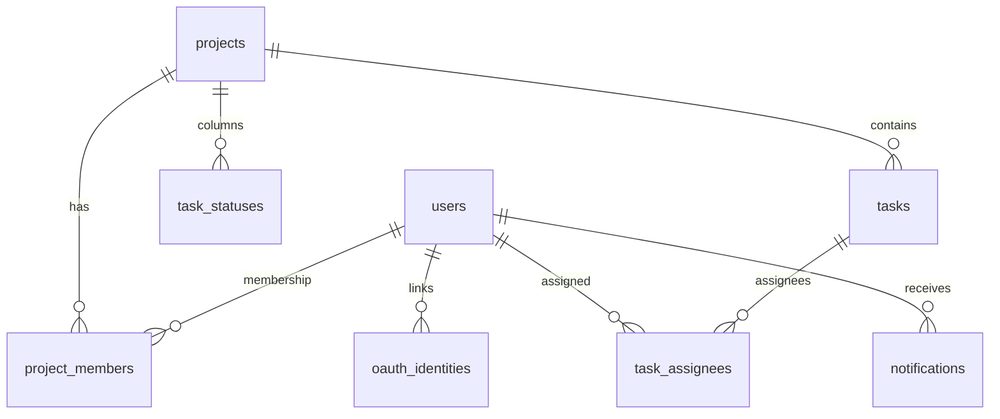

# База данных

## Движок

PostgreSQL 16. Технические имена пользователя/БД по умолчанию: `track` / `track` (legacy volumes).  
Хост-порт в Docker: **5433** (чтобы не конфликтовать с локальным Postgres на 5432).

## Миграции

Каталог: `backend/alembic/versions/`.

| Rev | Суть |
|-----|------|
| 001–002 | Initial + projects |
| 003 | Invites |
| 004 | Web Push subscriptions |
| 005–006 | `projects.is_demo`, `users.is_demo` |
| 007 | Device push tokens (FCM) |
| 008–009 | Цвета статусов → Kanban presets |
| 010 | Leave requests |
| 011 | Email OTP codes |
| 012 | `platform_role`, OAuth identities, moderation, activity |

**Head:** `012_platform_admin_oauth`.  
Runtime: `alembic upgrade head` в lifespan (`main.py`).  
Тесты: `Base.metadata.create_all` на `track_test` — см. [../testing/](../testing/).

## Основные сущности

Ключевые таблицы (неполный список): `users`, `projects`, `project_members`, `task_statuses`, `tasks`, `task_assignees`, `comments`, `checklist_items`, `project_invites`, `notifications`, `push_subscriptions`, `device_push_tokens`, `email_codes`, OAuth/moderation из `models/platform.py`.

## Ограничения целостности

- `UniqueConstraint(project_id, user_id)` на `project_members`  
- Cascade delete members с проектом  
- Soft-delete задач: `deleted_at`  
- Demo isolation на уровне запросов списков проектов, не только UI
