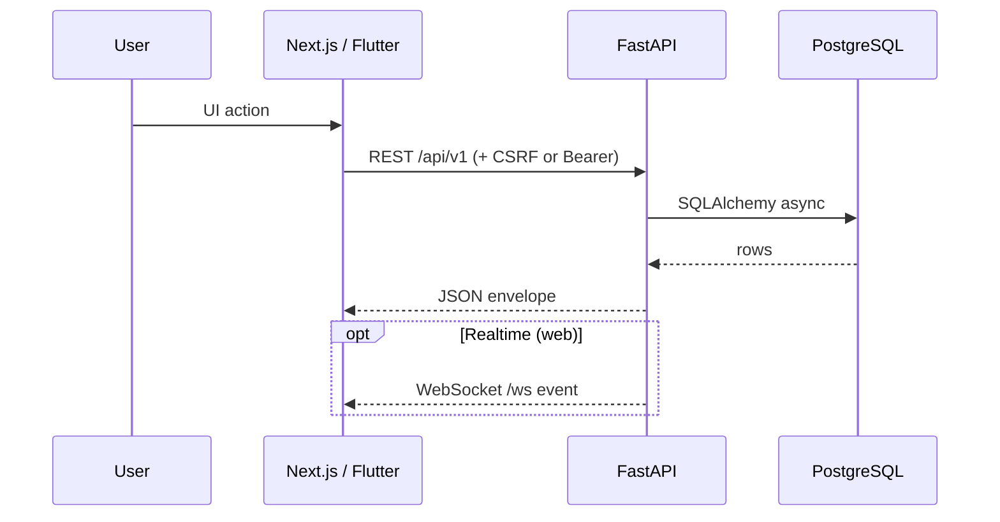

# Архитектура — обзор

Takt — монорепозиторий с тремя клиентами к одному API.

## Компоненты

| Компонент | Путь | Роль |
|-----------|------|------|
| API | `backend/` | Единый источник бизнес-правил и данных |
| Web | `frontend/` | Лендинг, workspace Kanban, platform admin |
| Mobile | `mobile/` | Flutter iOS/Android + home widgets |
| Proxy | `deploy/` + Compose `proxy` | TLS, `/` → frontend, `/api` `/ws` → backend |
| DB | PostgreSQL 16 | Volumes с legacy-префиксом `track_*` |

## Потоки данных

1. **Auth web:** login → httpOnly JWT cookies + CSRF cookie → mutating requests с заголовком CSRF.  
2. **Auth mobile:** login/OAuth → `access_token` / `refresh_token` в secure storage → `Authorization: Bearer`.  
3. **Доска:** `GET /projects` → `GET /settings/statuses?project_id=` → `GET /tasks?project_id=` → move/PATCH.  
4. **Уведомления:** `notify_service` пишет in-app + опционально Web Push / FCM.  
5. **Демо:** `is_demo` на project/user; системный admin не видит demo без membership.

## Границы ответственности

- **UI не является границей безопасности.** Проверки доступа — в `project_service.ensure_project_access` и platform deps.  
- **Бизнес-правила** (позиция задачи, удаление только автором, изоляция demo) — в `backend/app/services/`.  
- **Клиенты** дублируют DTO/модели для UX, но не «вторую правду» по ACL.

## Связанные документы

- [backend.md](backend.md) · [frontend.md](frontend.md) · [mobile.md](mobile.md) · [database.md](database.md)  
- [../security/README.md](../security/README.md) · [../decisions/](../decisions/)
